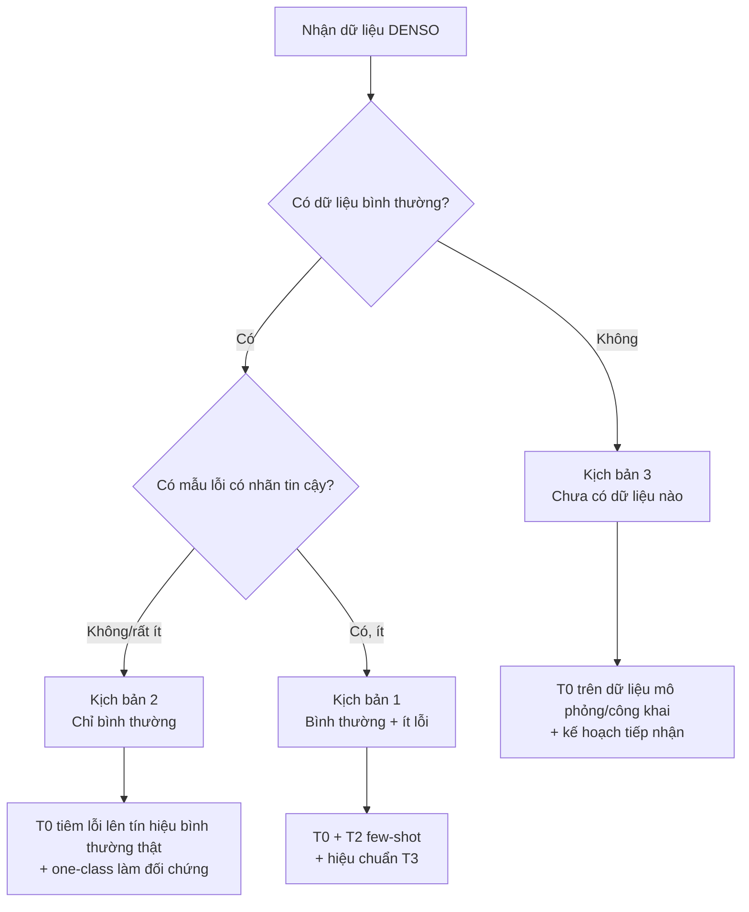
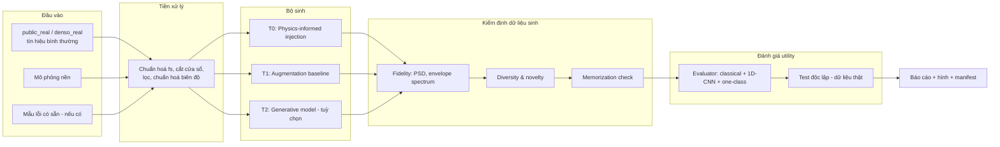

# FINAL PLAN — DENSO A1: Sinh dữ liệu bất thường cho phát hiện hỏng hóc

| Trường | Giá trị |
| --- | --- |
| **Mã dự án** | `DENSO-A1` |
| **Phiên bản tài liệu** | v1.0 (Execution-Ready) |
| **Trạng thái** | 🔴 Raw-waveform generation/augmentation closed; safety-gate/submission pivot |
| **Cập nhật lần cuối** | 2026-10-09 |
| **Chủ sở hữu tài liệu** | Solution Lead (người hỗ trợ giải pháp & code) |
| **Người review** | Team Lead, Slide Owner |
| **Tài liệu gốc** | `DENSO.md` (bối cảnh đội & bài toán) |
| **Deadline vòng 1** | ⚠️ `[CẦN XÁC NHẬN]` — plan dùng mốc tương đối (Day N), quy đổi ngày thật khi có deadline |

**Chú thích trạng thái:** ✅ Xác nhận · 🟡 Giả định (cần kiểm chứng) · ❓ Chưa biết · 🔴 Rủi ro/Blocker · ⬜ Chưa làm · 🔄 Đang làm · ☑ Xong

> **Current status addendum (2026-10-09).** T0, T0-v2, conditional-VAE T2 và T3 fault-preserving augmentation đều là các nhánh negative-result đã đóng. Không triển khai thêm generator, GAN, diffusion hoặc parameter search. Safety Gate validation đã PASS về mặt protocol/diagnostic behavior; SafetyGate-v1 đã freeze cho future DENSO validation. Xem `docs/adr/010-synthetic-data-safety-gate.md`, `docs/adr/011-safety-gate-v1-freeze.md`, `reports/safety_gate_validation.md` và `reports/final_negative_results.md`.

> **Superseding execution decision.** Các mô tả T0/T1/T2/T3 trong phần kế hoạch lịch sử bên dưới không còn là backlog triển khai. Quyết định bàn giao hiện tại là: dùng chung bốn gate provenance/validity, fidelity, novelty và held-out utility; retrospective đã reject cả bốn nhánh; submission/slide package phải trình bày safety-gate contribution và giới hạn chuyển giao sang DENSO, không trình bày một fault generator thành công.

---

## Mục lục

1. [Tóm tắt điều hành](#1-tóm-tắt-điều-hành)
2. [Bối cảnh & phát biểu bài toán](#2-bối-cảnh--phát-biểu-bài-toán)
3. [Mục tiêu, phạm vi, ngoài phạm vi](#3-mục-tiêu-phạm-vi-ngoài-phạm-vi)
4. [Tiêu chí thành công & Definition of Done](#4-tiêu-chí-thành-công--definition-of-done)
5. [Giả định, ràng buộc, phụ thuộc](#5-giả-định-ràng-buộc-phụ-thuộc)
6. [Các bên liên quan & RACI](#6-các-bên-liên-quan--raci)
7. [Chiến lược dữ liệu](#7-chiến-lược-dữ-liệu)
8. [Thiết kế giải pháp](#8-thiết-kế-giải-pháp)
9. [Thiết kế đánh giá & benchmark](#9-thiết-kế-đánh-giá--benchmark)
10. [Kiến trúc kỹ thuật & chuẩn kỹ nghệ](#10-kiến-trúc-kỹ-thuật--chuẩn-kỹ-nghệ)
11. [Work Breakdown Structure & lịch trình](#11-work-breakdown-structure--lịch-trình)
12. [Quality Gates](#12-quality-gates)
13. [Đăng ký rủi ro](#13-đăng-ký-rủi-ro)
14. [Câu hỏi mở cần xác nhận](#14-câu-hỏi-mở-cần-xác-nhận)
15. [Kế hoạch khi có dữ liệu thật DENSO](#15-kế-hoạch-khi-có-dữ-liệu-thật-denso)
16. [Bàn giao cho Slide Owner & chính sách tuyên bố](#16-bàn-giao-cho-slide-owner--chính-sách-tuyên-bố)
17. [Quản trị dự án](#17-quản-trị-dự-án)
18. [Phụ lục](#18-phụ-lục)
19. [Execution Contract cho AI/Agent](#19-execution-contract-cho-aiagent)
20. [Change Log của bản tối ưu](#20-change-log-của-bản-tối-ưu)

---

## 1. Tóm tắt điều hành

**Bài toán.** Ca hỏng hóc máy hiếm nên dữ liệu lỗi thường ít hơn nhiều so với dữ liệu vận hành bình thường. Đội chọn **A1** và tập trung vào **sinh dữ liệu bất thường/hỏng hóc phục vụ huấn luyện và đánh giá mô hình**, ưu tiên **tín hiệu rung dạng chuỗi thời gian**.

**Tình trạng hiện tại.** Đội **chưa được bàn giao dữ liệu DENSO ở vòng 1** và chưa biết chắc loại máy, cảm biến, tần số lấy mẫu, nhãn lỗi hay metric chấm chính thức. Vì vậy plan không được phụ thuộc vào một giả định cụ thể về máy DENSO.

### 1.1 Quyết định kiến trúc

Kiến trúc **lai theo tầng (tiered hybrid)**:

| Tầng | Phương pháp | Cần lỗi thật? | Vai trò |
| --- | --- | --- | --- |
| **T0** | Physics-informed fault injection lên tín hiệu bình thường/mô phỏng | Không | **Core vòng 1** |
| **T1** | Augmentation / resampling baseline | Có thể không, tùy baseline | **Đối chứng bắt buộc** |
| **T2** | cVAE / diffusion 1D / GAN | Có | **Optional; chỉ sau khi T0 được benchmark** |
| **T3** | Hiệu chuẩn miền với dữ liệu DENSO | Có dữ liệu mục tiêu | **Vòng sau** |

### 1.2 North-star question

> **Không hỏi “dữ liệu sinh có nhìn giống lỗi không?”, mà hỏi: “với cùng ngân sách dữ liệu và cùng evaluator, dữ liệu T0 có giúp mô hình phát hiện lỗi thật tốt hơn baseline hay không?”**

Mọi benchmark, gate và claim trong tài liệu đều phải phục vụ câu hỏi này.

### 1.3 Primary hypothesis

**H1 — Utility under scarce faults.** Khi số **nhóm lỗi thật** dùng cho train rất nhỏ, thêm T0 vào train sẽ cải thiện utility trên **test chỉ gồm dữ liệu thật/public-real giữ riêng**, so với baseline có cùng data budget.

Đây là hypothesis chính. Fidelity, PSD, envelope spectrum và hình tín hiệu chỉ là **bằng chứng cơ chế/chẩn đoán**, không thay thế utility.

### 1.4 Bằng chứng tối thiểu để vòng 1 đáng tin

1. Pipeline tái lập: config → generator → manifest → evaluator → report.
2. Split chống leakage ở **group level**, không random theo cửa sổ.
3. So sánh **budget-matched**: cùng số mẫu/budget giữa T0 và baseline.
4. Few-shot sweep theo số **fault groups** thật `k`, không chỉ số windows.
5. Paired runs: cùng split, cùng `k` subset, cùng evaluator seed giữa các phương pháp.
6. Test độc lập chứa **real/public-real faults**, không chứa generated samples.
7. Báo cáo effect size + uncertainty; không chỉ chọn một seed đẹp.
8. Claim–Evidence Matrix truy được từ slide → run ID → config → git commit.

### 1.5 Đầu ra

- Repo chạy lại được.
- Benchmark report + raw run manifests.
- Bộ hình/bảng cho slide.
- Claim–Evidence Matrix.
- Runbook tiếp nhận dữ liệu DENSO thật.
- Quyết định Go / Revise / Stop cho T0 dựa trên evidence, không dựa trên cảm quan.

---

## 2. Bối cảnh & phát biểu bài toán

### 2.1 Phát biểu bài toán

> Cần một phương pháp tạo thêm dữ liệu bất thường/hỏng hóc cho dữ liệu cảm biến máy móc (ưu tiên tín hiệu rung) nhằm hỗ trợ huấn luyện mô hình phát hiện bất thường khi dữ liệu lỗi thực tế khan hiếm; có cách thử nghiệm ở vòng 1 dù chưa có dữ liệu DENSO; có kế hoạch điều chỉnh và kiểm chứng khi nhận dữ liệu nhà máy ở các vòng sau.

### 2.2 Những điều đã xác nhận / chưa xác nhận

| # | Nội dung | Trạng thái |
| --- | --- | --- |
| F1 | Mã bài toán là **A1** | ✅ |
| F2 | Trọng tâm là sinh dữ liệu bất thường, không phải chế tạo thiết bị | ✅ (hướng đội theo đuổi) |
| F3 | Loại dữ liệu nổi bật: tín hiệu rung | 🟡 hướng ban đầu |
| F4 | Dữ liệu DENSO chưa được cung cấp ở vòng 1 | ✅ |
| F5 | Vòng 1 nộp *giải pháp + kế hoạch triển khai* (slide template + biểu mẫu ý tưởng) | 🟡 theo thông tin đội |
| F6 | Prototype được khuyến khích nhưng chưa xác nhận bắt buộc | 🟡 |
| F7 | Bắt buộc phần cứng / bắt buộc có mô hình phát hiện / metric chính thức / số slide / deadline | ❓ |

### 2.3 Điều **không** được suy diễn

- Không nói "DENSO không có dữ liệu" hay "DENSO chưa có mô hình AI" — chỉ biết *đội* chưa nhận được dữ liệu.
- Không biến tên đề bài ("thiết bị") thành yêu cầu phần cứng.
- Không coi humanoid robot / camera / LLM-điều-khiển là phạm vi A1.
- Không coi một loại máy hay danh sách lỗi cụ thể (vòng bi, động cơ…) là phạm vi chính thức; chỉ dùng làm **trường hợp thử nghiệm được chọn** và ghi rõ.

---

## 3. Mục tiêu, phạm vi, ngoài phạm vi

### 3.1 Mục tiêu (SMART-lite)

| ID | Mục tiêu | Đo bằng | Mức ưu tiên |
| --- | --- | --- | --- |
| G1 | Thiết kế phương pháp sinh dữ liệu bất thường có cơ sở rõ ràng, giải thích được | ADR được duyệt + sơ đồ phương pháp khớp code | Must |
| G2 | Prototype chạy lại được từ đầu vào → dữ liệu sinh → hình minh họa | Một lệnh `make demo` thành công trên máy sạch | Must |
| G3 | Chứng minh (hoặc phủ định trung thực) giá trị của dữ liệu sinh trên nhiệm vụ phát hiện | Bảng benchmark đa seed, tập test độc lập | Must |
| G4 | Làm rõ đường chuyển từ prototype sang dữ liệu DENSO thật | Runbook §15 + checklist dữ liệu | Must |
| G5 | Cung cấp đủ tài liệu/hình để Slide Owner diễn đạt chính xác | Gói bàn giao §16 được Slide Owner xác nhận đủ dùng | Must |
| G6 | Cho thấy khả năng thích nghi sang nhiều máy | Thử nghiệm cross-condition / cross-dataset (nếu còn thời gian) | Should |
| G7 | Tầng T2 (mô hình sinh học được) | Có kết quả so với T0/T1 | Could |

### 3.2 Trong phạm vi (In scope)

- Sinh dữ liệu rung dạng chuỗi thời gian (đơn kênh trước, đa kênh/đa trục là mở rộng).
- Prototype + benchmark trên **dữ liệu công khai hoặc mô phỏng** do đội chọn và mô tả.
- Mô hình phát hiện **làm công cụ đánh giá** (evaluator), không phải sản phẩm.
- Tài liệu, README, cấu hình, metadata truy vết.
- Kế hoạch tiếp nhận & điều chỉnh khi có dữ liệu DENSO.

### 3.3 Ngoài phạm vi (Out of scope) — trừ khi được xác nhận bằng văn bản

- Thiết kế phần cứng, chọn cảm biến, mạch đo, triển khai tại nhà máy.
- Dự đoán thời gian còn lại trước khi hỏng (RUL), tối ưu lịch bảo trì.
- Hệ thống cảnh báo thời gian thực, dashboard vận hành.
- Chẩn đoán vật lý đầy đủ mọi loại lỗi của mọi loại máy.
- Dữ liệu ảnh/video/chuyển động robot.
- Nền tảng phần mềm lớn (MLOps đầy đủ, serving…).

### 3.4 Ưu tiên theo MoSCoW

| Mức | Hạng mục |
| --- | --- |
| **Must** | T0 + T1 + evaluator + benchmark đa seed + README + gói slide + runbook dữ liệu thật |
| **Should** | Kiểm tra fidelity (phổ, envelope), kiểm tra memorization, thí nghiệm few-shot sweep, cross-condition |
| **Could** | T2 (cVAE/diffusion/GAN 1D), đa kênh, giao diện demo nhỏ |
| **Won't (vòng 1)** | Phần cứng, RUL, real-time, đa loại máy đã kiểm chứng |

---

## 4. Tiêu chí thành công, Hypothesis & Definition of Done

> Metric chính thức của cuộc thi **chưa được xác nhận**. Metric và ngưỡng dưới đây là **protocol nội bộ**; không được gọi là tiêu chí chính thức của DENSO/BTC.

### 4.1 Hypothesis registry

| ID | Hypothesis | So sánh chính | Bằng chứng tối thiểu | Nếu không đạt |
| --- | --- | --- | --- | --- |
| **H1** | T0 hữu ích khi fault data khan hiếm | T0 vs E0/T1 budget-matched | ΔPR-AUC / Δmacro-F1 và recall@fixed-FPR trên real/public-real test | Không claim utility; phân tích failure |
| **H2** | T0 tạo đúng cấu trúc được thiết kế | T0 output vs target mechanism | Envelope/PSD + property tests | Sửa generator trước benchmark |
| **H3** | Lợi ích không chỉ do “thêm nhiều mẫu” | T0 vs copy-oversample / simple augmentation cùng `m` | Paired effect | Nếu ngang nhau → T0 chưa chứng minh giá trị |
| **H4** | Lợi ích tồn tại trên nhiều mức khan hiếm | Sweep `k` theo fault groups | Learning curve + CI | Giới hạn claim vào vùng `k` có evidence |
| **H5** | Kết quả không do leakage/condition identity | Group holdout + cross-condition (nếu có) | Audit split + E6 | Hạ claim về in-condition only |

### 4.2 Success không dùng một “magic number”

Không hard-code kiểu “phải tăng ≥ X%” khi chưa có rubric hoặc business threshold. Trước G1, đội phải pre-register:

- **Primary metric**: ưu tiên `PR-AUC` cho mất cân bằng.
- **Operational metric**: `Recall @ fixed FPR` khi bài toán phù hợp; FPR được chọn **trước** khi xem test.
- **Secondary**: F1/macro-F1, ROC-AUC, calibration nếu cần.
- **Effect size**: chênh lệch tuyệt đối `Δmetric` giữa paired runs.
- **Uncertainty**: 95% CI trên paired differences.
- **Practical threshold δ**: chỉ đặt nếu mentor/rubric/business requirement cung cấp cơ sở. Nếu chưa có, báo effect size + CI và tránh gắn nhãn “đủ lớn về thực tế”.

### 4.3 Quy tắc diễn giải pre-registered

- **Strong evidence**: paired mean/median effect theo hướng tốt, CI không chồng 0, và không vi phạm leakage/budget checks.
- **Promising but uncertain**: effect phần lớn dương nhưng CI còn chứa 0 hoặc số group test quá ít.
- **Parity**: effect gần 0 trong vùng bất định.
- **Negative**: effect nhất quán xấu hơn baseline.
- Không chuyển metric chính sau khi thấy test.
- Không chọn seed đẹp.
- Không tối ưu generator trực tiếp trên test.
- Kết quả âm vẫn giữ trong report.
- Kết quả trên public/simulated data **không** được suy diễn thành hiệu quả tại DENSO.

> `≥5 seeds` chỉ là mức sàn kỹ thuật, **không tự động tạo ra độc lập thống kê** nếu các run dùng cùng một test group. Report phải ghi rõ nguồn biến thiên đến từ split/model/generator.

### 4.4 Definition of Done cho một experiment

Một experiment chỉ được coi là **Done** khi có đủ:

- [ ] Config immutable hoặc hash được.
- [ ] `split_seed`, `subset_seed`, `generator_seed`, `model_seed` được log riêng.
- [ ] Git commit + environment + dataset checksum/version.
- [ ] Train/val/test group IDs được lưu.
- [ ] Generated sample có `parent_ids` và parent chỉ thuộc train.
- [ ] Data budget giữa các phương pháp được kiểm và log.
- [ ] Không fit scaler/feature selection/hyperparameter trên test.
- [ ] Raw per-run metrics + aggregate report.
- [ ] Paired comparison với baseline tương ứng.
- [ ] Claim–Evidence Matrix được cập nhật nếu kết quả lên slide.

### 4.5 Definition of Done cho vòng 1

- [ ] T0 + T1 + evaluator + E0/E1/E2/E4 chạy end-to-end.
- [ ] G2 property/fidelity checks PASS.
- [ ] G3 leakage audit PASS.
- [ ] Benchmark có paired runs và uncertainty.
- [ ] `make demo` hoặc lệnh tương đương chạy từ checkout sạch.
- [ ] README + `data_onboarding.md` + handoff package hoàn tất.
- [ ] Mọi claim trên slide có evidence hoặc được ghi rõ là “planned”.

---

## 5. Giả định, ràng buộc, phụ thuộc

### 5.1 Giả định (cần kiểm chứng)

| ID | Giả định | Nếu sai thì | Cách kiểm chứng |
| --- | --- | --- | --- |
| A1 | Dữ liệu DENSO là rung 1D (1 hoặc vài kênh), lấy mẫu đều | Điều chỉnh tiền xử lý & kiến trúc | Hỏi ban tổ chức / xem dữ liệu vòng sau |
| A2 | Có thể tìm ≥ 1 bộ dữ liệu rung công khai phù hợp, có điều khoản sử dụng chấp nhận được | Dùng hoàn toàn dữ liệu mô phỏng | Khảo sát §7.4 |
| A3 | Vòng sau sẽ có dữ liệu thật | Chỉ dừng ở prototype tổng quát | Hỏi ban tổ chức |
| A4 | Có GPU/CPU đủ cho mô hình nhỏ (1D-CNN, cVAE) | Giữ T0/T1 + model cổ điển | Kiểm tra tài nguyên |
| A5 | Lỗi cơ khí quay (vòng bi…) là ví dụ hợp lý để minh họa | Chọn ví dụ khác | Ý kiến chuyên gia/mentor |

### 5.2 Ràng buộc

- Chưa có dữ liệu DENSO; chưa có metric chính thức.
- Đội có nền tảng AI/ML tổng quát nhưng chưa chốt giải pháp; nhân lực phần giải pháp/code hạn chế.
- Quyền sử dụng dữ liệu công khai/nhà máy phải được tôn trọng (license, NDA nếu có).
- Slide phải theo template; mentor yêu cầu **tối đa 3 link tài liệu, mỗi link ≤ 100 từ mô tả**.
- Deadline, số slide, thời lượng: `[CẦN XÁC NHẬN]`.

### 5.3 Phụ thuộc

| ID | Phụ thuộc | Bên cung cấp | Chặn việc gì |
| --- | --- | --- | --- |
| D1 | Hướng dẫn nộp chính thức, deadline, rubric | Team Lead / BTC | Chốt phạm vi tối thiểu |
| D2 | Xác nhận "có bắt buộc mô hình phát hiện không" | BTC / mentor | Mức đầu tư vào evaluator |
| D3 | Chọn & duyệt dataset công khai | Solution Lead + Team Lead | P1 |
| D4 | Template slide + biểu mẫu ý tưởng | Slide Owner | P5 |
| D5 | Chuyên gia hiểu máy/lỗi (nếu có) | Mentor/BTC | Kiểm tra ý nghĩa bất thường |

---

## 6. Các bên liên quan & RACI

| Vai trò | Người | Trách nhiệm chính |
| --- | --- | --- |
| **Team Lead / PM** | `[TBD]` | Quyết định phạm vi, làm việc với BTC/mentor, duyệt gate |
| **Solution Lead** | `[TBD]` (người hỗ trợ) | Thiết kế phương pháp, code, benchmark, tài liệu kỹ thuật |
| **Slide Owner** | `[TBD]` | Slide, biểu mẫu ý tưởng; đối chiếu hướng dẫn chính thức |
| **Domain mentor** | `[TBD]` | Góp ý ý nghĩa vật lý của bất thường |
| **BTC / DENSO** | — | Dữ liệu, metric, quy định (nguồn xác nhận) |

**RACI** (R = Thực hiện, A = Chịu trách nhiệm cuối, C = Tham vấn, I = Được thông báo)

| Hạng mục | Team Lead | Solution Lead | Slide Owner | Mentor |
| --- | --- | --- | --- | --- |
| Chốt phạm vi & ADR | A | R | C | C |
| Chọn dataset | C | R/A | I | C |
| Cài đặt generator & evaluator | I | R/A | I | C |
| Benchmark & phân tích | C | R/A | I | C |
| Claim–Evidence Matrix | A | R | R | I |
| Slide & biểu mẫu | A | C | R | I |
| Đối chiếu hướng dẫn chính thức | A | I | R | I |
| Kế hoạch dữ liệu thật | A | R | C | C |

---

## 7. Chiến lược dữ liệu

### 7.1 Phân loại nguồn dữ liệu (bắt buộc dùng nhất quán trong code, hình, slide)

| Nhãn `source_type` | Ý nghĩa | Được gọi là "dữ liệu DENSO"? |
| --- | --- | --- |
| `denso_real` | Dữ liệu máy mục tiêu, **chỉ khi đã được bàn giao** | ✅ |
| `public_real` | Dữ liệu đo thật từ nguồn công khai, có nguồn & điều kiện đo riêng | ❌ |
| `simulated` | Tạo từ mô hình/quy tắc mô phỏng đã mô tả | ❌ |
| `generated` | Đầu ra của bộ sinh đề xuất | ❌ |

> Tuyệt đối không dùng chung nhãn "real data" cho `public_real` khiến người nghe hiểu là dữ liệu DENSO. Không dùng `generated` làm bằng chứng duy nhất rằng bộ sinh giúp phát hiện lỗi thật.

### 7.2 Ba kịch bản dữ liệu & phương pháp phù hợp



| Kịch bản | Đội đang ở đâu? | Phương pháp dùng được | Phương pháp **không** nên tuyên bố |
| --- | --- | --- | --- |
| 1. Bình thường + ít lỗi | Chưa biết | T0, T1, T2 (few-shot), T3 | T2 học tốt từ 1–2 mẫu lỗi |
| 2. Chỉ bình thường / nhãn không tin cậy | Chưa biết | T0, T1, one-class | Mọi thay đổi trên tín hiệu là "lỗi thật" |
| 3. Chưa có dữ liệu máy mục tiêu | ✅ **Hiện tại** | T0 trên dữ liệu thay thế | Hiệu quả tại nhà máy DENSO |

### 7.3 Dữ liệu cho prototype vòng 1 — chiến lược hai chân

| Chân | Mục đích | Có thể kết luận gì | Không được kết luận gì |
| --- | --- | --- | --- |
| **Public measurement (`public_real`)** | Đo utility trên dữ liệu đo thật từ nguồn công khai | Hiệu quả trên dataset/condition đó | Hiệu quả tại DENSO |
| **Simulated** | Kiểm tra pipeline, parameter control, edge cases | Generator hoạt động theo thiết kế | Đại diện lỗi công nghiệp thực tế |

**Quy tắc:** utility claim phải dựa trên test `public_real`/`denso_real` giữ riêng. `simulated` chỉ là validation cơ chế.

### 7.4 Phân loại thêm “nguồn gốc lỗi”

`source_type = public_real` chỉ nói **tín hiệu được đo thật**, không đồng nghĩa lỗi phát sinh tự nhiên. Thêm trường `fault_origin`:

| Giá trị | Ý nghĩa |
| --- | --- |
| `field_observed` | Lỗi ghi nhận trong vận hành thực |
| `accelerated_degradation` | Lỗi xuất hiện trong thí nghiệm run-to-failure/accelerated life |
| `seeded_physical` | Lỗi vật lý được tạo/chủ động gây ra trong setup thử nghiệm |
| `algorithmic_injection` | Bất thường được thuật toán chèn vào |
| `unknown` | Không đủ thông tin |

Điều này ngăn việc gọi một fault được tạo trong phòng thí nghiệm là “natural real fault”.

### 7.5 Ứng viên dataset công khai — shortlist khảo sát, chưa chốt

| Ứng viên | Loại | Điểm cần kiểm tra trước G1 |
| --- | --- | --- |
| CWRU Bearing Data Center | Rung vòng bi, lỗi vật lý chủ động, nhiều tải | Grouping theo raw recording; tránh window leakage; fault origin |
| Paderborn bearing dataset | Rung + dòng, nhiều điều kiện | Loại damage; group/machine identity; license |
| NASA/IMS bearing | Run-to-failure | Cách định nghĩa normal/degradation/failure; split theo bearing/run |
| MFPT | Rung vòng bi | Quy mô, grouping, license |
| XJTU-SY | Run-to-failure | Label semantics, condition holdout, license |

**Rubric chọn dataset (1–5):**

1. Có group identity rõ để chống leakage.
2. Có fault labels/condition metadata đủ dùng.
3. Có ít nhất một cách holdout theo machine/run/condition.
4. License cho phép benchmark và công bố kết quả.
5. Tần số lấy mẫu/measurement setup được mô tả đủ.
6. Có đủ fault groups để làm `k`-sweep mà không lấy nhiều windows từ cùng một group.
7. Có fault origin rõ.
8. Có thể tải/checksum/reproduce.

**Hard reject:** dataset không thể xây group split đáng tin hoặc license không đủ rõ cho mục đích sử dụng.

**Đầu ra:** `docs/dataset_survey.md`, Data Card, ADR-002, ADR-004.

### 7.6 Schema metadata bắt buộc

| Trường | Kiểu | Ý nghĩa |
| --- | --- | --- |
| `sample_id` | str | Duy nhất |
| `source_type` | enum | `denso_real` / `public_real` / `simulated` / `generated` |
| `fault_origin` | enum | Bảng §7.4 |
| `source_dataset`, `source_version` | str | Dataset + version |
| `raw_record_id` | str | File/run/bearing/machine gốc |
| `group_id` | str | Đơn vị **không được tách qua split** |
| `condition_id` | str/null | Tải/tốc độ/chế độ nếu biết |
| `parent_ids` | list[str] | Parent sample IDs |
| `parent_group_ids` | list[str] | Parent groups; phải thuộc train |
| `split_role` | enum | `train` / `val` / `test` |
| `fs_hz` | float | Tần số lấy mẫu |
| `n_channels`, `n_samples` | int | Shape |
| `units` | str | Đơn vị |
| `label_binary` | 0/1 | Bình thường/bất thường |
| `label_condition` | str | Điều kiện/kiểu injection; không overclaim physical fault |
| `severity` | float/null | Cường độ nếu có |
| `generator`, `generator_version` | str/null | Generator |
| `config_hash` | str | Cấu hình |
| `split_seed`, `subset_seed`, `generator_seed` | int/null | RNG provenance |
| `operating_cond` | dict | Metadata condition |
| `created_at` | datetime | Thời gian tạo |

**Invariant:** sample `generated` không được có parent từ validation/test.

### 7.7 Data split hierarchy

Ưu tiên đơn vị split từ mạnh đến yếu:

`machine/bearing/run → raw recording → operating condition → window`

**Không bao giờ** chia ngẫu nhiên theo window nếu nhiều window sinh từ cùng raw recording.

Nếu dataset cho phép:

- **Primary split:** group holdout trong cùng condition.
- **Stress split:** holdout condition hoặc machine.
- **Cross-dataset:** exploratory, chỉ sau khi đã harmonize `fs`, semantics và label mapping.

---

## 8. Thiết kế giải pháp

### 8.1 Kiến trúc tổng thể



### 8.2 Tầng T1 — Baseline augmentation/resampling

T1 là **đối chứng**, không phải một nhóm thao tác được áp dụng giống nhau cho mọi `k`.

**Khi `k > 0` fault groups có thật:**
- copy oversampling lỗi thật;
- jitter/scaling/time-shift nhẹ trên fault train;
- class-weight;
- optionally MixUp nếu semantics phù hợp.

**Khi `k = 0`:**
- T1 **không được giả vờ sinh fault class từ không có fault sample**;
- baseline hợp lệ là one-class/normal-only evaluator;
- T0 có thể sinh pseudo-fault train từ normal-train, sau đó test trên held-out real faults.

Mọi E1/E2 phải **budget-match** số training examples hoặc ghi rõ ngân sách khác nhau.

### 8.3 Tầng T0 — Physics-informed fault injection (core)

**Mô hình.** T0 chồng một thành phần bất thường có tham số lên tín hiệu nền bình thường. Với ví dụ rotating machinery/bearing, thành phần này có thể gồm impulse train, jitter/slip, damped resonance, amplitude modulation và noise.

**Ba parameter modes:**
1. Có geometry + shaft speed → tính characteristic frequencies theo công thức.
2. Không có geometry → generic periodic-impulse mode; không gắn physical-fault label cụ thể.
3. Có ít fault samples → calibration mode; chỉ fit trên **train/validation**, không trên test.

**Physical/numerical guards bắt buộc:**
- `0 < f_fault < fs/2` và mọi harmonic/resonance dùng trong generator phải được xử lý chống aliasing.
- Không tạo `f_res` vượt vùng tín hiệu mà preprocessing giữ lại.
- Định nghĩa SNR nhất quán và log công thức.
- Biên độ injection được chuẩn hóa theo RMS/robust scale của parent signal thay vì một hằng số tùy ý.
- Tránh discontinuity ở biên window nếu generator tạo trực tiếp từng cửa sổ.
- Nếu speed-varying, frequency law phải phụ thuộc `f_r(t)` thay vì dùng một `f_fault` cố định.
- Parent signal và mọi statistic dùng để calibrate phải thuộc train.
- Mỗi injection operator có property test riêng.

**Các thành phần điều khiển:**

| Thành phần | Tham số | Property test |
| --- | --- | --- |
| Impulse train | `f_fault`, phase, amplitude | Inter-arrival/frequency đúng trong tolerance |
| Jitter/slip | jitter distribution | Mean period không drift ngoài spec |
| Damped resonance | `f_res`, damping | Energy peak/band phù hợp |
| Amplitude modulation | mod frequency/depth | Sideband/AM signature xuất hiện |
| Noise/background | SNR | SNR đo lại nằm trong tolerance |
| Speed variation | `f_r(t)` | Instantaneous fault frequency theo law |

**Bearing characteristic frequencies** chỉ được dùng khi geometry đủ:

```text
BPFO = (n/2) · f_r · (1 − (d/D)·cos φ)
BPFI = (n/2) · f_r · (1 + (d/D)·cos φ)
BSF  = (D/(2d)) · f_r · (1 − ((d/D)·cos φ)^2)
FTF  = (f_r/2) · (1 − (d/D)·cos φ)
```

**Claim boundary:** T0 mô phỏng một **mechanism-like signal component**; không tự biến generated sample thành bằng chứng lỗi vật lý thật.

### 8.4 Tầng T2 — Learned generator (Optional, sau G3)

T2 chỉ được mở khi:

- T0/T1 benchmark đã hoàn thành;
- có đủ fault groups thật để train/validate mà vẫn giữ test độc lập;
- team còn compute/time;
- có câu hỏi rõ T2 cần trả lời.

Ưu tiên thử **một** family, không chạy “model zoo”. Residual-on-physics có thể là hướng sau này nhưng **không phải Must vòng 1**.

### 8.5 Tầng T3 — DENSO calibration

Khi có dữ liệu DENSO:

1. Profile `fs`, channels, units, missingness, saturation, stationarity.
2. Xác định group identity và label provenance.
3. Freeze real test set trước calibration.
4. Calibrate preprocessing + T0 parameters chỉ trên train/val.
5. Re-run E0/E1/E2/E4.
6. Chỉ sau đó mới tạo claim DENSO-specific.

### 8.6 Quyết định kiến trúc (ADR)

| ADR | Quyết định | Gate |
| --- | --- | --- |
| ADR-001 | T0 core; T1 baseline; T2 optional | G0 |
| ADR-002 | Dataset chính + dự phòng | G1 |
| ADR-003 | Evaluator set | G1 |
| ADR-004 | Group split + condition stress split | G1 |
| ADR-005 | Primary metric + fixed-FPR policy | G1 |
| ADR-006 | `k` values + synthetic budget `m` | G1 |
| ADR-007 | Có mở T2 không | Sau G3 |

---

## 9. Thiết kế đánh giá & benchmark — Evaluation Contract

### 9.1 Invariants

Các điều kiện này **không được phá**:

1. Test là immutable sau G1.
2. Test không chứa generated samples cho utility evaluation.
3. Parent của generated sample chỉ đến từ train.
4. Split ở group level; không random-window split.
5. Preprocessing statistic fit trên train.
6. Generator tuning chỉ dùng train/val.
7. Evaluator architecture/hyperparameter search budget giống nhau giữa methods.
8. So sánh chính là **paired**: cùng split, cùng `k` subset, cùng evaluator seed.
9. Data/sample budget phải budget-match hoặc được báo rõ.
10. Mọi experiment sinh raw manifest trước khi tổng hợp.

### 9.2 Hai protocol khác nhau theo `k`

#### Protocol A — `k = 0` real fault groups trong train

Mục tiêu: kiểm tra T0 có tạo supervision hữu ích từ **normal train only** hay không.

- Train normal: real/public-real normal groups.
- T0: inject vào normal-train → generated pseudo-fault.
- Baseline A0: one-class normal-only.
- Optional A1: heuristic anomaly augmentation nếu có định nghĩa độc lập.
- Test: held-out **real/public-real fault + normal groups**.

**Không dùng T1 fault augmentation** vì không có fault sample để augment.

#### Protocol B — `k > 0` real fault groups

Mục tiêu: kiểm tra synthetic augmentation có giúp trong few-shot regime.

- Chọn `k` theo **fault groups**, không theo windows.
- E0: real-only.
- E1a: copy oversampling / class-weight.
- E1b: simple signal augmentation.
- E2: T0.
- E3: T0 + T1 nếu cần.
- Test real/public-real giữ nguyên.

### 9.3 `k`-sweep và sampling

Không chốt dãy `k` trước khi biết số fault groups. Ở G1:

- xác định tổng fault groups khả dụng;
- chọn khoảng 4–6 điểm `k` từ zero-shot → very-few-shot → few-shot;
- không dùng `k` lớn đến mức làm train/test group split vô nghĩa;
- với mỗi `k`, sample **group subset** bằng `subset_seed`;
- các method dùng đúng **cùng subset**.

Ví dụ ký hiệu: `k ∈ K = {0, k1, k2, k3, ...}` — giá trị thật lưu trong ADR-006.

### 9.4 Synthetic budget `m`

Với mỗi `k`, chọn budget theo **ratio trên real train** hoặc số sample cố định. Mọi method so sánh phải log:

- số real-normal windows;
- số real-fault windows;
- số generated/augmented windows;
- tổng training examples;
- sampling policy mỗi epoch.

Nếu T0 dùng `2×` data nhưng T1 chỉ dùng `1×`, đó không phải so sánh công bằng trừ khi mục tiêu riêng là budget sweep.

### 9.5 Evaluator set

**Primary evaluator:** chọn một evaluator đủ mạnh nhưng ổn định ở G1.

**Secondary sanity evaluator:** một family khác để kiểm tra kết quả không phụ thuộc duy nhất một model.

Ứng viên từ plan hiện tại:

- Handcrafted features + RF/GBM.
- Small 1D-CNN.
- One-class model cho `k=0`.

Không chạy nhiều model chỉ để chọn model cho kết quả đẹp.

### 9.6 Seed taxonomy

Không gộp tất cả thành một `seed`.

| Seed | Điều khiển | Ghép cặp giữa method? |
| --- | --- | --- |
| `split_seed` | Train/val/test groups | **Có** |
| `subset_seed` | Fault groups được chọn cho `k` | **Có** |
| `generator_seed` | T0/T1 randomness | Có cấu trúc paired khi hợp lý |
| `model_seed` | Weight init / training order | **Có** |

**Minimum:** ≥5 paired run tuples cho result vòng 1. Nếu đủ compute, tăng số paired tuples thay vì thêm evaluator/model không cần thiết.

### 9.7 Ma trận experiment tối ưu

| ID | Thiết lập | Mục đích | Priority |
| --- | --- | --- | --- |
| **E0** | Real-only | Baseline | Must |
| **E1a** | Oversample/class-weight | Kiểm soát class imbalance | Must |
| **E1b** | Simple augmentation | Baseline augmentation | Must khi `k>0` |
| **E2** | T0 budget-matched | Test H1/H3 | Must |
| **E4** | `k`-sweep: E0/E1/E2 | **Primary experiment** | Must |
| **E5** | `m`-sweep cho T0 | Saturation / harm | Should |
| **E6** | Condition/machine holdout | External validity | Should |
| **E7** | Cross-dataset | Exploratory transfer | Could |
| **E8** | `k=0`: one-class vs T0-supervised | Zero-fault regime | Must nếu dataset hỗ trợ |
| **E9** | T0 ablation | Mechanism importance | Should |
| **E10** | T2 vs T0 | Learned generator value | Could, sau G3 |

### 9.8 Fidelity / diversity / novelty

Fidelity là **diagnostic**, không phải primary success metric.

| Khía cạnh | Phép kiểm | Cách dùng |
| --- | --- | --- |
| Spectral | PSD/log-spectral distance | Check gross mismatch |
| Mechanism | Envelope spectrum / harmonic structure | Check operator did intended action |
| Feature distribution | RMS/kurtosis/crest/band-power + MMD/Wasserstein | Diagnose distribution gap |
| Diversity | Pairwise/feature-space dispersion | Detect low variety |
| Memorization | NN distance to train | Mainly T2 |
| C2ST | Classifier real-vs-generated | Diagnostic only |

Không tối ưu trực tiếp generator để “đánh lừa C2ST” nếu utility xấu.

### 9.9 Metric & statistical report

Mỗi result table có:

- per-run metric;
- paired baseline metric;
- `Δ = method - baseline`;
- mean/median Δ;
- 95% CI trên paired Δ;
- number of unique train/test groups;
- `k`, `m`, seed tuple count;
- fault origin của dataset;
- test condition.

**Primary:** PR-AUC nếu phù hợp mất cân bằng.

**Operational secondary:** Recall@fixed-FPR khi định nghĩa event/window hợp lý.

**Không dùng p-value đơn lẻ làm bằng chứng chính.** Effect size + CI + protocol validity quan trọng hơn.

### 9.10 Leakage audit

- [ ] Không có `group_id` overlap train/val/test.
- [ ] Không có raw-record overlap.
- [ ] Hash duplicate check.
- [ ] Parent/ancestor của generated sample chỉ thuộc train.
- [ ] Scaler/filter statistics không fit trên test.
- [ ] Feature selection không dùng test.
- [ ] Threshold chọn trên validation.
- [ ] Generator hyperparameter không dùng test.
- [ ] `k`-subset không lấy nhiều windows từ cùng fault group để giả thành nhiều fault examples.
- [ ] Test group list được freeze trước benchmark.

### 9.11 Threats to validity

| Threat | Ví dụ | Countermeasure | Claim bị giới hạn |
| --- | --- | --- | --- |
| Construct | PR-AUC tốt nhưng false alarm cao | thêm Recall@fixed-FPR | Không claim operational utility chỉ từ PR-AUC |
| Internal | Window leakage | group split + hash audit | Kết quả invalid nếu fail |
| Statistical | Nhiều windows nhưng ít fault groups | report unique groups + paired group sampling | Không coi windows là độc lập |
| External | Dataset khác DENSO | condition holdout + explicit scope | Không claim DENSO |
| Synthetic bias | T0 tạo signature quá dễ | baseline + ablation + cross-condition | Claim chỉ trong tested regime |
| Model dependence | Chỉ một evaluator hưởng lợi | secondary evaluator sanity check | Giới hạn claim nếu không replicate |

### 9.12 Decision rule sau benchmark

- **GO:** T0 có utility evidence trên primary experiment và không fail audit.
- **REVISE:** mechanism checks pass nhưng utility chưa rõ → calibrate parameter distribution / simplify model / inspect mismatch.
- **STOP/DEFER:** T0 không hơn budget-matched baseline hoặc tạo shortcut artifacts → không đầu tư T2 chỉ để “cứu” câu chuyện; báo kết quả và chuyển trọng tâm sang phương án có evidence.

---

## 10. Kiến trúc kỹ thuật & chuẩn kỹ nghệ

### 10.1 Cấu trúc repository

```
denso-a1/
├── README.md                  # Bài toán, phương pháp, dữ liệu, giới hạn, quickstart
├── plan.md                    # Tài liệu này
├── LICENSE
├── CHANGELOG.md
├── CITATION.cff
├── Makefile                   # make setup | demo | test | lint | bench | report
├── pyproject.toml             # Phụ thuộc + cấu hình tool
├── uv.lock / requirements.lock# Khoá phiên bản
├── .pre-commit-config.yaml
├── .github/workflows/ci.yml
├── configs/                   # YAML (Hydra/OmegaConf)
│   ├── data/  generator/  eval/  experiment/
├── data/                      # KHÔNG commit dữ liệu thô (git-ignore, dùng DVC/script tải)
│   ├── raw/  interim/  processed/  generated/
├── src/denso_a1/
│   ├── data/                  # loaders, schema, splits, preprocessing
│   ├── generators/            # base.py, augment.py (T1), physics.py (T0), learned/ (T2)
│   ├── eval/                  # evaluators, metrics, fidelity, memorization
│   ├── viz/                   # plot tín hiệu, PSD, envelope
│   ├── export/                # xuất dữ liệu cho pipeline huấn luyện khác
│   └── cli.py
├── experiments/               # script/notebook chạy E0–E10; kết quả có versioned
├── tests/                     # unit + property-based + regression
├── docs/
│   ├── adr/  dataset_survey.md  method.md  benchmark_report.md
│   ├── handoff/               # gói cho Slide Owner
│   └── data_onboarding.md     # runbook dữ liệu thật
└── reports/                   # hình, bảng xuất ra (có manifest)
```

### 10.2 Công nghệ đề xuất

| Lớp | Lựa chọn | Lý do |
| --- | --- | --- |
| Ngôn ngữ | Python ≥ 3.10 | Hệ sinh thái ML/tín hiệu |
| Tín hiệu | NumPy, SciPy (`signal`) | Chuẩn |
| ML cổ điển | scikit-learn | Baseline, one-class |
| Học sâu (nếu cần) | PyTorch | Linh hoạt |
| Cấu hình | Hydra/OmegaConf hoặc YAML + pydantic | Tái lập, kiểm schema |
| Theo dõi thí nghiệm | MLflow hoặc ghi log JSONL đơn giản | Truy vết |
| Phiên bản dữ liệu | DVC (nếu cần) hoặc script tải + checksum | Không commit dữ liệu lớn |
| Chất lượng | `ruff`, `black`, `mypy`, `pytest`, `pre-commit` | Chuẩn công nghiệp |
| CI | GitHub Actions | Tự động test |
| Môi trường | `uv`/`pip-tools` + Dockerfile (tùy chọn) | Tái lập |

### 10.3 Chuẩn code

- Giao diện `Generator` thống nhất: `fit(data) → self`, `generate(n, seed, **cond) → SampleBatch` (tín hiệu + metadata).
- Type hints toàn bộ API công khai; docstring nêu **giả định** của mỗi bộ sinh.
- Mọi yếu tố ngẫu nhiên nhận `seed`/`Generator` rõ ràng (không dùng global RNG).
- Quy ước Git: nhánh `main` bảo vệ; PR nhỏ; Conventional Commits; ≥ 1 reviewer.
- Test tối thiểu: phổ envelope có đỉnh tại `f_fault` (T0); tái lập cùng seed; schema hợp lệ; không rò rỉ split; kiểm tra biên độ/độ dài đúng.
- Độ phủ test cho `src/denso_a1/generators` và `eval` ≥ 80% *(chuẩn kỹ nghệ nội bộ, không phải tuyên bố kết quả)*.

### 10.4 Tái lập (reproducibility)

- Khoá phiên bản phụ thuộc; ghi `git_commit`, `config_hash`, `seed`, phiên bản thư viện, phần cứng vào mỗi lần chạy.
- `make demo` chạy trên CPU trong thời gian ngắn (mục tiêu: vài phút) với dữ liệu nhỏ/mô phỏng.
- Dữ liệu công khai tải qua script có checksum; tuân thủ license.
- Kết quả trong slide phải truy được tới một run ID/commit cụ thể.

### 10.5 Giao diện xuất dữ liệu (cho pipeline huấn luyện của DENSO/đội)

- `denso-a1 generate --config … --n … --seed … --out …` → `.npz`/Parquet + `manifest.parquet` đúng schema §7.6.
- Có hàm đọc mẫu (`load_generated(path)`) trả về `(X, y, meta)`.
- Dữ liệu sinh luôn mang `source_type = generated` và `parent_ids`.

### 10.6 Bảo mật & tuân thủ

- Không commit dữ liệu nhà máy; dùng `.gitignore`/DVC remote riêng khi có dữ liệu DENSO.
- Kiểm tra license từng dataset trước khi phân phối lại; ghi trong `docs/dataset_survey.md`.
- Không đưa thông tin nhận dạng nhà máy/NDA vào repo công khai.
- Nếu repo công khai: quét secret (pre-commit hook).

---

## 11. Work Breakdown Structure & lịch trình

> Deadline chưa xác nhận. Ước lượng dưới đây là **person-day sơ bộ cho 1 Solution Lead**, hiệu chỉnh khi biết deadline và số người. Day 0 = ngày khởi động.

### 11.1 Tổng quan giai đoạn

| Giai đoạn | Thời gian tương đối | Công sức | Đầu ra chính | Gate |
| --- | --- | --- | --- | --- |
| **P0. Khởi động & chốt phạm vi** | Day 0–1 | 1 | Plan duyệt, checklist câu hỏi gửi BTC | G0 |
| **P1. Khảo sát & chọn dữ liệu** | Day 1–3 | 2 | `dataset_survey.md`, ADR-002/004 | G1 |
| **P2. Nền tảng code & T1** | Day 2–5 | 3 | Repo skeleton, loaders, splits, T1, CI | — |
| **P3. Generator T0 + kiểm định** | Day 4–9 | 4–5 | T0, tests, fidelity report | G2 |
| **P4. Evaluator + benchmark** | Day 8–14 | 4–5 | Kết quả E0–E5 (+E6–E9 nếu kịp) | G3 |
| **P5. Tài liệu & gói bàn giao slide** | Day 12–16 | 2–3 | README, hình, bảng, Claim–Evidence Matrix | G4 |
| **P6. Kế hoạch dữ liệu thật** | Day 12–16 (song song) | 1–2 | Runbook §15, `data_onboarding.md` | G5 |
| **P7. (Could) T2** | Sau G3, nếu còn thời gian | 3–4 | E10 | — |
| **Buffer** | ~15–20% tổng | 2–3 | — | — |

**Tổng ước lượng lõi (Must + Should): ≈ 17–22 person-day.**

### 11.2 Execution profiles theo deadline

Vì deadline thật chưa xác nhận, không nên dùng một timeline duy nhất. Chọn profile ngay khi Q-C1 có câu trả lời.

| Profile | Khi dùng | Bắt buộc | Cắt |
| --- | --- | --- | --- |
| **72h Survival** | Deadline cực gấp | 1 dataset, T0 minimal, E0/E1/E2, 3 paired tuples, leakage audit, 1 figure + 1 table | T2, cross-dataset, CI phức tạp |
| **7-day Strong** | Một tuần | 1 dataset chính + fallback, E4 `k`-sweep, ≥5 paired tuples, E5 hoặc E9 | T2 trừ khi còn dư |
| **14–21 day Optimal** | Đủ thời gian | Full Must + Should, E6, robust report, second evaluator sanity | T2 vẫn optional |
| **Post-data DENSO** | Có data thật | T3 onboarding + re-run protocol | Không reuse public thresholds mù quáng |

**Nguyên tắc:** ưu tiên **experimental validity > số lượng experiment > model complexity**.

### 11.3 Chi tiết công việc

#### P0 — Khởi động & chốt phạm vi
- [ ] **0.1** Review `DENSO.md`, thống nhất bảng "đã xác nhận / chưa xác nhận" (§2.2).
- [ ] **0.2** Team Lead gửi danh sách câu hỏi ưu tiên cho BTC/mentor (§14).
- [ ] **0.3** Thống nhất phạm vi tối thiểu (MoSCoW §3.4) và scope-cut ladder (§11.5).
- [ ] **0.4** Chốt ADR-001; tạo repo, quyền truy cập.
- [ ] **0.5** Thiết lập kênh & nhịp họp (§17).

#### P1 — Khảo sát & chọn dữ liệu
- [x] **1.1** Khảo sát ≥ 3 dataset theo tiêu chí §7.4.
- [x] **1.2** Kiểm tra license/điều khoản từng dataset; CWRU license caveat được ghi rõ, Paderborn có CC BY-NC 4.0.
- [x] **1.3** Chọn dataset chính + dự phòng (ADR-002).
- [x] **1.4** Định nghĩa giao thức chia tập theo `group_id` (ADR-004).
- [x] **1.5** Chốt thiết lập benchmark & quy tắc diễn giải (pre-register §4.2, §9).

#### P2 — Nền tảng code & T1
- [ ] **2.1** Khởi tạo repo theo §10.1, `pyproject`, pre-commit, CI.
- [x] **2.2** Loader + schema metadata + checksum dữ liệu.
- [x] **2.3** Tiền xử lý (resample, cửa sổ, chuẩn hoá) + splitter chống leakage + test.
- [ ] **2.4** Generator interface + T1 augmentations.
- [ ] **2.5** Công cụ vẽ cơ bản (tín hiệu, PSD).

#### P3 — Generator T0 + kiểm định
- [ ] **3.1** Cài đặt toán tử T0: xung lặp, jitter, cộng hưởng, điều biên, nhiễu nền.
- [ ] **3.2** Hàm tính tần số đặc trưng vòng bi (ghi rõ điều kiện áp dụng).
- [ ] **3.3** Ba chế độ tham số (§8.3).
- [ ] **3.4** Unit test: đỉnh envelope tại `f_fault`, tái lập seed, schema.
- [ ] **3.5** Fidelity/diversity/novelty report (§9.8).
- [ ] **3.6** Demo script `make demo` + hình minh họa.

#### P4 — Evaluator + benchmark
- [ ] **4.1** Evaluator: đặc trưng + RF/GBM; 1D-CNN; one-class.
- [x] **4.2** Chạy E0, E1, E2 (Must) với ≥ 5 seed; E1 được loại khỏi `k=0` theo protocol không có fault train.
- [x] **4.3** Chạy E4 (quét `k`) — thí nghiệm chính.
- [ ] **4.4** Chạy E5, E8, E9; sau đó E6, E7 nếu kịp.
- [x] **4.5** Phân tích kết quả, kể cả kết quả âm; ghi giới hạn.
- [x] **4.6** Bảng + hình benchmark với khoảng tin cậy.

#### P5 — Tài liệu & bàn giao
- [x] **5.1** README (bài toán, phương pháp, dữ liệu, quickstart, giới hạn).
- [x] **5.2** `docs/method.md` + sơ đồ khớp code.
- [ ] **5.3** Gói bàn giao slide (§16.1) + Claim–Evidence Matrix (§16.3).
- [ ] **5.4** Chọn ≤ 3 link tài liệu nền, mỗi link ≤ 100 từ mô tả.
- [ ] **5.5** Review chéo với Slide Owner; chỉnh theo phản hồi.

#### P6 — Kế hoạch dữ liệu thật
- [x] **6.1** Soạn `data_onboarding.md` (checklist kiểm dữ liệu).
- [ ] **6.2** Định nghĩa các nhánh xử lý theo kịch bản 1/2/3 (§15).
- [ ] **6.3** Ghi rõ tham số nào đổi theo máy, cần dữ liệu gì để thích nghi.

### 11.4 Mốc (Milestones)

| Mốc | Mô tả | Điều kiện đạt |
| --- | --- | --- |
| **M0** | Plan được duyệt | G0 |
| **M1** | Dataset & protocol đóng băng | G1 |
| **M2** | Generator MVP chạy demo | G2 |
| **M3** | Benchmark Must hoàn tất | G3 |
| **M4** | Gói bàn giao slide hoàn tất | G4 |
| **M5** | Runbook dữ liệu thật sẵn sàng | G5 |

### 11.5 Scope-cut ladder (nếu thiếu thời gian — cắt từ dưới lên)

1. ❌ T2 (cVAE/diffusion/GAN)
2. ❌ E7 cross-dataset, E10
3. ❌ E6 cross-condition, E3
4. ❌ Đa kênh
5. ⚠️ Giảm số seed xuống 3 (ghi rõ trong báo cáo)
6. ⚠️ Giảm evaluator còn đặc trưng + RF
7. 🚫 **Không cắt:** T0, T1, E0–E2, E4, README, gói slide, runbook dữ liệu thật, Claim–Evidence Matrix

### 11.6 Đường găng (Critical path)

`P0 → P1 (chọn dataset) → P2 (loader + splits) → P3 (T0) → P4 (E0–E4) → P5 (bàn giao)`

Nút thắt chính: **chọn dataset** (D3) và **xác nhận phạm vi/hướng dẫn nộp** (D1). Nếu D1 chưa có, giữ nguyên phạm vi tối thiểu.

---

## 12. Quality Gates

| Gate | Exit criteria bắt buộc | Fail thì làm gì |
| --- | --- | --- |
| **G0 — Scope Lock** | ADR-001 accepted; unknowns được đánh dấu; không overclaim DENSO | Giữ scope tối thiểu, không code thêm feature ngoài scope |
| **G1 — Data & Protocol Freeze** | Dataset + license + Data Card; immutable test groups; ADR-003/004/005/006; metric + `k/m` + seed protocol pre-registered | Không benchmark utility trước khi pass |
| **G2 — Generator Validity** | T0 property tests pass; aliasing/SNR guards pass; schema/provenance pass; envelope/PSD diagnostic hợp lý | Sửa generator; không chạy benchmark lớn |
| **G3 — Benchmark Validity** | E0/E1/E2/E4 hoàn tất; paired/budget-matched; leakage audit pass; raw manifests có đủ | Result không được lên slide nếu audit fail |
| **G4 — Evidence Ready** | Tables/figures traceable; Claim–Evidence Matrix complete; negative results included | Không chốt claim |
| **G5 — Submission Ready** | Slide handoff + README + demo + link rules + limitations | Fix submission package |
| **G6 — DENSO Ready** | `data_onboarding.md`; security/NDA path; T3 protocol | Chưa claim production readiness |

**Hard-stop conditions:**
- test leakage;
- test dùng để tune generator;
- generated data xuất hiện trong utility test;
- không phân biệt unique groups với windows;
- slide có số không truy được về run ID.

---

## 13. Đăng ký rủi ro

Thang: **L** (Likelihood) và **I** (Impact) = Thấp / Trung bình / Cao.

| ID | Rủi ro | L | I | Chiến lược giảm thiểu | Dấu hiệu cảnh báo | Chủ |
| --- | --- | --- | --- | --- | --- | --- |
| R1 | Dữ liệu DENSO thật khác xa prototype → phương pháp không chuyển được | Cao | Cao | Runbook §15; T0 tham số hoá; nêu rõ giả định; không tuyên bố vượt phạm vi | Dữ liệu vòng sau khác `fs`/kênh/hình thái | Solution Lead |
| R2 | Dữ liệu sinh "trông giống" nhưng không giúp phát hiện lỗi thật | TB | Cao | Đo utility trên test lỗi thật; baseline T1; báo cáo trung thực | E2 ≈ E0/E1 | Solution Lead |
| R3 | Data leakage làm benchmark ảo | TB | Cao | Chia theo `group_id`; checklist §9.10; review chéo | Kết quả tốt bất thường | Solution Lead |
| R4 | Slide tuyên bố vượt bằng chứng | TB | Cao | Claim–Evidence Matrix; Slide Owner đối chiếu §16.2 | Slide có số không có run ID | Team Lead |
| R5 | Không tìm được dataset phù hợp/license không rõ | Thấp–TB | TB | Dataset dự phòng; chuyển sang `simulated` + nêu giới hạn | Khảo sát P1 không có ứng viên | Solution Lead |
| R6 | Thiếu thời gian | TB | Cao | Scope-cut ladder §11.5; Must/Should/Could rõ | Trễ gate > 1 ngày | Team Lead |
| R7 | Hiểu sai yêu cầu chính thức (bắt buộc phần cứng/mô hình phát hiện) | TB | TB | Hỏi BTC sớm (D1, D2); thiết kế modular để bổ sung | Hướng dẫn nộp xuất hiện yêu cầu mới | Team Lead |
| R8 | Tuyên bố nhãn lỗi vật lý khi không có cơ sở | TB | TB | `label_condition` phản ánh điều kiện sinh; mentor review | Nhãn nêu tên lỗi cụ thể mà không có hình học/tần số | Solution Lead |
| R9 | Mô hình sinh học được ghi nhớ/sao chép mẫu hiếm | TB | TB | Kiểm nearest-neighbor; chỉ dùng T2 khi có mẫu & giải thích được | Khoảng cách NN rất nhỏ | Solution Lead |
| R10 | Thiếu tài nguyên tính toán | Thấp | TB | Ưu tiên T0/T1 + model nhỏ; giảm quy mô | Training quá lâu | Solution Lead |
| R11 | Vi phạm license/NDA dữ liệu | Thấp | Cao | Kiểm license; không commit dữ liệu; tách repo riêng khi có dữ liệu DENSO | Dữ liệu lạ xuất hiện trong repo | Team Lead |
| R12 | Phụ thuộc vào một người (bus factor) | TB | TB | Tài liệu, review chéo, `make demo` | Kiến thức nằm trong đầu một người | Team Lead |
| R13 | Mô tả vấn đề sai ("DENSO không có dữ liệu/AI") | Thấp | TB | Dùng cách diễn đạt §2.3 | — | Slide Owner |
| R14 | `k` đếm windows thay vì fault groups → few-shot claim giả | TB | Cao | `k` luôn theo group; report unique groups | k lớn nhưng chỉ từ 1 raw run | Solution Lead |
| R15 | T0 thắng chỉ vì có nhiều training samples hơn | Cao | Cao | Budget-matched baselines + E5 | Tổng train size khác nhau | Solution Lead |
| R16 | Generator học/tune từ test | Thấp–TB | Cao | Immutable test; config freeze G1 | Param được đổi sau khi xem test | Team Lead |
| R17 | Aliasing/shortcut artifact làm classifier học dấu vết generator | TB | Cao | Nyquist guards, C2ST diagnostic, E9, condition holdout | Accuracy rất cao bất thường | Solution Lead |
| R18 | Nhiều seed nhưng cùng few-shot groups → uncertainty bị hiểu sai | TB | TB | Tách split/subset/model/generator seeds | CI quá hẹp so với ít groups | Solution Lead |


---

## 14. Câu hỏi mở cần xác nhận

Nguồn: `DENSO.md` §2.3 & §3.11. **Cột "Chặn?"** chỉ những câu hỏi ảnh hưởng quyết định lớn; các câu khác không cần chờ để làm prototype.

### 14.1 Về cuộc thi / yêu cầu nộp (Team Lead + Slide Owner đối chiếu hướng dẫn chính thức)

| # | Câu hỏi | Chặn? | Trạng thái |
| --- | --- | --- | --- |
| Q-C1 | Deadline vòng 1; số slide; thời lượng | Có (lịch) | ❓ |
| Q-C2 | Có bắt buộc prototype/GitHub/benchmark/demo? | Có (phạm vi) | ❓ |
| Q-C3 | Có bắt buộc mô hình phát hiện hỏng hóc? | Có (evaluator) | ❓ |
| Q-C4 | Có bắt buộc phần cứng? | Có | ❓ |
| Q-C5 | Rubric/metric chấm kỹ thuật | Không | ❓ |
| Q-C6 | Định dạng nộp cuối cùng | Không | ❓ |
| Q-C7 | 3 link tài liệu nền: tiêu chí chọn? | Không | 🟡 |

### 14.2 Về dữ liệu & máy (hỏi BTC/mentor; ghi lại để chuẩn bị dữ liệu vòng sau)

| # | Câu hỏi | Ảnh hưởng |
| --- | --- | --- |
| Q-D1 | Máy mục tiêu: loại, số lượng, đồng nhất? | Phạm vi tổng quát hoá |
| Q-D2 | Vị trí/loại cảm biến, số trục/kênh, đơn vị | Tiền xử lý, hình dạng dữ liệu |
| Q-D3 | `fs`, độ dài bản ghi, liên tục hay cắt sẵn | Cửa sổ, dải tần phân tích |
| Q-D4 | Một file = một lần đo/ca/máy/sự kiện? | `group_id`, chia tập |
| Q-D5 | Metadata kèm: mã máy, thời gian, chế độ, cảm biến | Điều kiện sinh |
| Q-D6 | Định nghĩa & nguồn nhãn "bất thường"; phân loại lỗi? | Loại bài toán (nhị phân/đa lớp) |
| Q-D7 | Lượng dữ liệu bình thường/lỗi; phân bố giữa các máy | Chọn kịch bản 1/2/3 |
| Q-D8 | Dữ liệu trước/trong/sau hỏng; lịch sử bảo trì | Hiệu chuẩn, nhãn theo thời gian |
| Q-D9 | Thay đổi tải/tốc độ có được đánh dấu? | Tránh nhầm với lỗi |
| Q-D10 | Có kênh bổ sung: dòng điện, âm thanh, nhiệt độ, tốc độ quay | Mở rộng đa phương thức |
| Q-D11 | DENSO muốn nhận dữ liệu sinh ở định dạng nào, đưa vào pipeline nào? | `export/` |
| Q-D12 | Hạn chế sử dụng/lưu trữ/công khai dữ liệu nhà máy | Tuân thủ |
| Q-D13 | Có chuyên gia hiểu máy/lỗi để đối chiếu? | Kiểm định ý nghĩa |

### 14.3 Về nguồn lực (Team Lead)

| # | Câu hỏi |
| --- | --- |
| Q-R1 | GPU/ngân sách/thời gian chạy khả dụng? |
| Q-R2 | Số thành viên & phân công đầy đủ? |

---

## 15. Kế hoạch khi có dữ liệu thật DENSO

### 15.1 Quy trình tiếp nhận (Onboarding runbook)

1. **Tiếp nhận & bảo mật:** lưu ở kho riêng, kiểm quyền sử dụng/NDA, **không đưa vào repo công khai**.
2. **Kiểm tra cấu trúc:** định dạng file, `fs`, số kênh, đơn vị, độ dài, giá trị thiếu/bão hoà/kênh chết.
3. **Kiểm tra nhãn & metadata:** nguồn nhãn, tính nhất quán, lịch bảo trì; gán `group_id`.
4. **Xác định kịch bản** (1/2/3) bằng thống kê số lượng bình thường/lỗi theo máy.
5. **Điều chỉnh tiền xử lý** theo thông số thật (dải tần, lọc, cửa sổ).
6. **Xây mốc so sánh (baseline)** bằng dữ liệu thật, giữ riêng **tập test thật**.
7. **Sinh dữ liệu** theo nhánh phù hợp (bảng dưới).
8. **Đánh giá** trên phần dữ liệu thật giữ riêng; so E0 vs E1 vs E2 (vs T2).
9. **Đối chiếu chuyên gia** ý nghĩa các bất thường sinh ra.
10. **Báo cáo** kèm giới hạn; cập nhật Claim–Evidence Matrix.

### 15.2 Nhánh xử lý theo kịch bản

| Kịch bản | Hành động | Đánh giá |
| --- | --- | --- |
| **1. Bình thường + ít lỗi** | Hiệu chuẩn T0 từ mẫu lỗi thật; cân nhắc T2 (few-shot) / residual-on-physics | E4 với `k` thật; test lỗi thật giữ riêng |
| **2. Chỉ bình thường / nhãn kém** | T0 trên tín hiệu bình thường thật; dùng chuyên gia xác định tần số/điều kiện; one-class làm đối chứng | Không có test lỗi thật → **không tuyên bố** utility trên lỗi thật; đánh giá gián tiếp (độ tách giữa bình thường và sinh, ý kiến chuyên gia), ghi rõ giới hạn |
| **3. Chưa tiếp cận** | Tiếp tục prototype tổng quát, nêu tham số cần thu thập | Không có số liệu DENSO |

### 15.3 Thích nghi sang nhiều máy

| Hạng mục | Thay đổi theo máy? | Cần dữ liệu gì | Có phải huấn luyện lại? |
| --- | --- | --- | --- |
| Tần số đặc trưng (`f_fault`) | Có | Hình học/tốc độ hoặc phổ bình thường | Không (tính/ước lượng) |
| Tần số cộng hưởng, tắt dần | Có | Mẫu lỗi hoặc đáp ứng xung | Không/ít |
| Mức nhiễu nền | Có | Dữ liệu bình thường | Không |
| Evaluator | Có thể | Dữ liệu train theo máy | Có (nếu dùng học được) |
| Cấu hình T0 | Chỉ cấu hình | — | Không |

Kiểm tra khả năng chuyển: E6/E7 (cross-condition/cross-dataset) trên dữ liệu công khai; chỉ nêu "hướng mở rộng cần kiểm chứng" nếu chưa thử trên nhiều máy.

---

## 16. Bàn giao cho Slide Owner & chính sách tuyên bố

### 16.1 Gói bàn giao (`docs/handoff/`)

| # | Nội dung | Trạng thái |
| --- | --- | --- |
| H1 | Đoạn giải thích ngắn vấn đề thiếu dữ liệu lỗi & cách giải pháp hỗ trợ | ⬜ |
| H2 | Mô tả đầu vào → xử lý → đầu ra → cách dùng dữ liệu sinh | ⬜ |
| H3 | Sơ đồ phương pháp **khớp code đã triển khai** | ⬜ |
| H4 | Ví dụ tín hiệu bình thường vs sinh (ghi `source_type` & điều kiện) | ⬜ |
| H5 | Hình giải thích dạng bất thường (PSD, envelope spectrum) | ⬜ |
| H6 | Bảng benchmark: thiết lập, metric, số đã chạy, phạm vi kết luận | ⬜ |
| H7 | Link repo + hướng dẫn chạy demo | ⬜ |
| H8 | Kế hoạch tiếp nhận & điều chỉnh dữ liệu DENSO (§15) | ⬜ |
| H9 | Giới hạn, giả định, câu hỏi chưa xác nhận | ⬜ |
| H10 | ≤ 3 link tài liệu nền, mỗi link ≤ 100 từ mô tả | ⬜ |
| H11 | Claim–Evidence Matrix (§16.3) | ⬜ |

### 16.2 Chính sách tuyên bố (Claims policy)

| ✅ Được nói (khi đã có bằng chứng) | 🚫 Không được nói |
| --- | --- |
| "Prototype sinh được mẫu bất thường có cấu trúc X, tái lập được." | "Giải pháp phát hiện X% lỗi tại DENSO." |
| "Trên dataset công khai Y, thêm dữ liệu sinh thay đổi F1/PR-AUC từ A sang B (n seed, CI)." *(chỉ khi đã đo)* | Bất kỳ số % cải thiện/downtime/chi phí khi chưa có số đo |
| "Phương pháp dựa trên giả định G; sẽ hiệu chuẩn khi có dữ liệu thật." | "Hoạt động trên mọi loại máy/mọi loại lỗi." |
| "Mô phỏng/giả lập dạng bất thường kiểu BPFO." | "Đây là lỗi vòng ngoài thật." (khi chỉ là mô phỏng) |
| "Metric là thiết kế nội bộ của đội." | "Metric chính thức của cuộc thi là …" (khi chưa xác nhận) |
| Kết quả âm/không kết luận được, kèm phân tích | Chỉ nêu kết quả đẹp, giấu kết quả không cải thiện |

**Quy tắc vàng:** *Chưa chạy → ghi là "mục tiêu/kế hoạch". Đã chạy → kèm điều kiện thực nghiệm.*

### 16.3 Claim–Evidence Matrix (mẫu; cập nhật liên tục)

| ID | Tuyên bố (trên slide) | Loại | Bằng chứng (run ID / file) | Phạm vi áp dụng | Trạng thái | Người duyệt |
| --- | --- | --- | --- | --- | --- | --- |
| C1 | Pipeline sinh được mẫu bất thường tái lập | Kỹ thuật | `tests/…`, `make demo` | Prototype | ⬜ | |
| C2 | Envelope spectrum của mẫu T0 có đỉnh tại `f_fault` | Fidelity | `reports/fidelity/…` | Dữ liệu `simulated` + `public_real` | ⬜ | |
| C3 | T0 so với T1/E0 trên dataset Y | Utility | `experiments/E2/…` | Dataset Y, ≥ 5 seed | ⬜ | |
| C4 | Kế hoạch tiếp nhận dữ liệu thật | Kế hoạch | `docs/data_onboarding.md` | Vòng sau | ⬜ | |
| C5 | Benchmark không có group leakage | Validity | `reports/audits/split_audit.json` | Dataset Y | ⬜ | |
| C6 | T0 được so với baseline cùng data budget | Fairness | run manifests E1/E2 | Primary benchmark | ⬜ | |
| C7 | Kết quả few-shot dùng `k` fault groups, không phải windows | Statistical validity | split manifests | E4 | ⬜ | |

---

## 17. Quản trị dự án

### 17.1 Nhịp làm việc

| Hoạt động | Tần suất | Nội dung |
| --- | --- | --- |
| Stand-up ngắn | Hằng ngày (≤ 15 phút) | Xong gì / làm gì / vướng gì |
| Demo nội bộ | Cuối mỗi giai đoạn | Chạy `make demo`, xem kết quả |
| Review gate | Mỗi gate G0–G5 | Kiểm exit criteria §12 |
| Review chéo code | Mỗi PR | ≥ 1 reviewer |
| Đồng bộ với Slide Owner | Sau G2, G3, G4 | Cập nhật Claim–Evidence Matrix |

### 17.2 Quản lý thay đổi

- Thay đổi phạm vi → ghi vào **Decision Log** (§17.3), cập nhật MoSCoW, Team Lead duyệt.
- Thay đổi phương pháp → ADR mới hoặc cập nhật ADR (trạng thái *Superseded*).
- Kết quả đã đưa vào slide mà bị thay đổi → cập nhật Claim–Evidence Matrix và báo Slide Owner ngay.

### 17.3 Decision Log

| Ngày | ID | Quyết định | Lý do | Người quyết định |
| --- | --- | --- | --- | --- |
| | | | | |

### 17.4 Báo cáo trạng thái (mẫu ngắn)

```
Tuần/ngày: __   Gate hiện tại: __   RAG: 🟢/🟡/🔴
Đã xong:        …
Đang làm:       …
Kế tiếp:        …
Rủi ro/Blocker: …
Cần quyết định: …
```

---

## 18. Phụ lục

### 18.1 Thuật ngữ

| Thuật ngữ | Giải thích |
| --- | --- |
| **A1** | Mã bài toán "Thiết bị phát hiện hỏng hóc" |
| **Anomaly / Bất thường** | Tín hiệu lệch khỏi vận hành bình thường |
| **PSD** | Phổ mật độ công suất |
| **Envelope spectrum** | Phổ của đường bao tín hiệu, thường dùng để lộ tần số lặp của va chạm |
| **BPFO / BPFI / BSF / FTF** | Tần số đặc trưng lỗi vòng ngoài / vòng trong / con lăn / vòng giữ của vòng bi |
| **TSTR** | Train on Synthetic, Test on Real |
| **C2ST** | Classifier Two-Sample Test |
| **ADR** | Architecture Decision Record |
| **MoSCoW** | Must / Should / Could / Won't |
| **RACI** | Responsible / Accountable / Consulted / Informed |
| **Leakage** | Thông tin từ test lọt vào quá trình học/chọn mô hình |

### 18.2 Mẫu ADR (`docs/adr/NNN-title.md`)

```markdown
# ADR-NNN: <Tiêu đề quyết định>

- Trạng thái: Proposed | Accepted | Superseded by ADR-XXX
- Ngày: YYYY-MM-DD
- Người quyết định: <tên/vai trò>

## Bối cảnh
<Vấn đề, ràng buộc, dữ liệu hiện có>

## Các phương án đã cân nhắc
1. <Phương án A> — ưu / nhược
2. <Phương án B> — ưu / nhược

## Quyết định
<Chọn gì>

## Lý do
<Vì sao; học từ dữ liệu nào; cần bao nhiêu mẫu lỗi; kiểm chứng đầu ra thế nào>

## Hệ quả & giới hạn
<Điều phải chấp nhận, giả định, khi nào xem xét lại>
```

### 18.3 Mẫu nhật ký thí nghiệm (`experiments/<ID>/log.md`)

```markdown
# Experiment <ID> — <name>

## Provenance
- date / owner:
- git_commit:
- environment_lock_hash:
- dataset / source_version / checksum:
- fault_origin:

## Split
- split_seed:
- train_group_ids:
- val_group_ids:
- test_group_ids:
- group_overlap_check: PASS/FAIL

## Few-shot selection
- k_fault_groups:
- subset_seed:
- selected_fault_group_ids:

## Synthetic / augmentation budget
- method:
- m_generated:
- generator_seed:
- real_normal_count:
- real_fault_count:
- generated_count:
- total_train_count:

## Evaluator
- evaluator:
- hyperparameters:
- model_seed:
- threshold_policy:

## Results
- primary_metric:
- baseline_metric:
- delta:
- secondary_metrics:
- paired_run_key:
- 95CI_delta:

## Audits
- parent_train_only: PASS/FAIL
- duplicate_hash: PASS/FAIL
- preprocessing_train_only: PASS/FAIL
- budget_match: PASS/FAIL

## Interpretation
- supported claim:
- unsupported claim:
- limitations:
- next action: GO / REVISE / STOP

## Artefacts
- run_id:
- config:
- raw_metrics:
- plots:
```

### 18.4 Checklist trước khi nộp slide

- [ ] Mọi con số trên slide có dòng trong Claim–Evidence Matrix.
- [ ] Mọi hình ghi rõ `source_type` & điều kiện.
- [ ] Không có tuyên bố nằm trong cột 🚫 §16.2.
- [ ] Sơ đồ phương pháp khớp code (`git tag` phiên bản dùng trong slide).
- [ ] Link repo hoạt động; `make demo` chạy từ checkout sạch.
- [ ] Đã đối chiếu số slide, thời lượng, định dạng nộp với hướng dẫn chính thức.
- [ ] ≤ 3 link tài liệu, mỗi link ≤ 100 từ mô tả.
- [ ] Đã nêu giới hạn & kế hoạch dữ liệu thật.
- [ ] `k` trên slide là số **fault groups**, không phải số windows.
- [ ] T0 vs baseline là budget-matched hoặc có chú thích rõ.
- [ ] Mỗi chart ghi số unique train/test groups.
- [ ] Không có result nào từ run fail leakage audit.
- [ ] Mọi “improvement” có paired baseline và uncertainty.

### 18.5 Tài liệu tham khảo nên đọc (khảo sát, chưa chốt 3 link nộp)

Chọn tối đa 3 nguồn cho bài nộp từ các nhóm chủ đề sau (tìm và xác minh nguồn trước khi trích dẫn):

1. **Chẩn đoán lỗi vòng bi bằng phân tích envelope / spectral kurtosis** — nền tảng cho T0 & kiểm tra envelope.
2. **Data augmentation cho chuỗi thời gian / sinh dữ liệu lỗi cho chẩn đoán máy** — nền tảng cho T1/T2.
3. **Dataset công khai được chọn** — trang mô tả chính thức (nguồn, điều kiện đo, license).

---

## 19. Execution Contract cho AI/Agent

Agent triển khai plan phải tuân thủ thứ tự này và **không tự ý mở rộng scope**.

### 19.1 Thứ tự bắt buộc

1. Đọc `plan.md` + ADR hiện có.
2. Hoàn tất G0.
3. Tạo `docs/dataset_survey.md` + Data Card.
4. Freeze split/protocol tại G1.
5. Implement data schema + split audit trước generator.
6. Implement T1 baseline.
7. Implement T0 + property tests.
8. Pass G2.
9. Implement evaluator.
10. Chạy smoke benchmark 1 seed để bắt bug.
11. Chạy E0/E1/E2 paired.
12. Chạy E4 `k`-sweep.
13. Aggregate metrics + CI.
14. Pass leakage/budget audits.
15. Chạy Should experiments theo thời gian còn lại.
16. Cập nhật Claim–Evidence Matrix.
17. Build handoff + README + final report.

### 19.2 Agent MUST NOT

- Không dùng test để chỉnh generator/hyperparameter.
- Không tự đổi primary metric sau khi thấy result.
- Không tính `k` bằng windows.
- Không gọi generated sample là “DENSO data”.
- Không thêm T2 trước khi G3 xong.
- Không benchmark hàng loạt khi smoke run chưa pass.
- Không đi tiếp qua gate nếu hard-stop fail.
- Không tự điền số performance chưa đo.

### 19.3 Mỗi task agent phải trả về

```text
STATUS: PASS | BLOCKED | FAIL
GATE: Gx
FILES_CHANGED:
COMMANDS_RUN:
TESTS:
RESULTS:
AUDITS:
OPEN_RISKS:
NEXT_SINGLE_ACTION:
```

Điều này giúp team kiểm soát agent và tránh “làm nhiều nhưng không biết bằng chứng nằm ở đâu”.

---

## 20. Change Log của bản tối ưu

Bản v1.0 giữ nguyên thesis gốc **T0 physics-informed + T1 baseline + T2 optional + T3 calibration**, nhưng siết những điểm dễ làm benchmark mất giá trị:

1. Chuyển trọng tâm từ “synthetic realism” sang **downstream utility**.
2. Định nghĩa hypothesis H1–H5.
3. Tách rõ protocol `k=0` và `k>0`.
4. Đếm few-shot theo **fault groups**, không theo windows.
5. Tách bốn loại seed.
6. Bắt buộc paired comparison.
7. Bắt buộc budget-matched baseline.
8. Thêm fault-origin taxonomy.
9. Thêm numerical/physical guards cho T0.
10. Thêm threat-to-validity matrix.
11. Thêm hard-stop gates.
12. Thêm deadline profiles.
13. T2 bị khóa đến sau G3.
14. Thêm execution contract để AI/agent không drift khỏi protocol.

**Tiêu chí “optimal” của plan này:** nếu kết quả T0 tốt, team có evidence đủ chặt để bảo vệ claim; nếu T0 không tốt, plan vẫn cho ra một kết luận trung thực, tái lập được và chỉ rõ bước sửa tiếp theo.

---

*Hết tài liệu. Mọi mục đánh dấu `[CẦN XÁC NHẬN]`, `[TBD]` hoặc ❓ phải được cập nhật trước Gate G1.*
